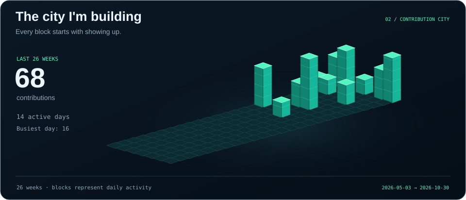
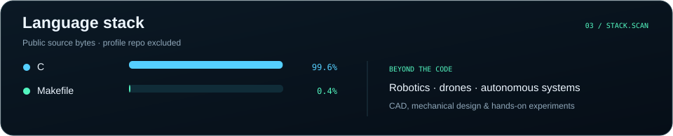
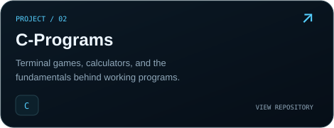
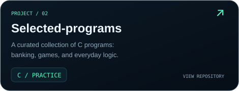
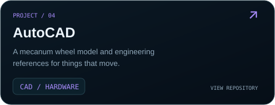
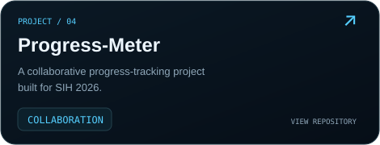

  

  <a href="mailto:garv.pahwa007@gmail.com">Let's connect ↗</a>
  &nbsp; · &nbsp;
  <a href="https://github.com/garvpahwa007?tab=repositories">Explore my repositories</a>
  &nbsp; · &nbsp;
  Dehradun, India

I'm **Garv**, a computer science student at **DIT University** and a hands-on builder. I enjoy connecting software with the physical world: learning how robots move, how drones fly, and how an idea becomes a working prototype.

Currently sharpening my **C and Python programming** and exploring **robotics, drone technology, and mechanical design**.

  

  

### Selected work

  
  
   
  
  

Building, learning, and shipping one project at a time.

<!-- Artwork is generated from public GitHub data by .github/scripts/generate_profile.py.
     Stats refresh daily with GitHub Actions. The city shows the last 26 weeks;
     the header shows GitHub's rolling-year contribution total. -->
